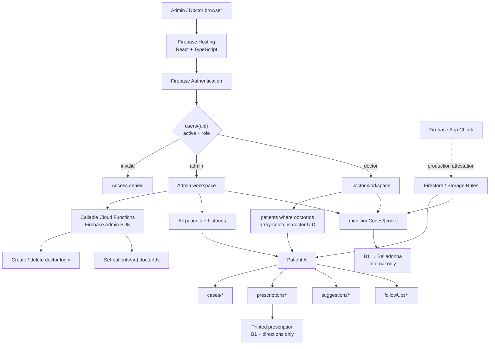

# Patient Case Manager

Firebase-ready patient case management for a clinic with role-based doctor access, administrator-controlled patient sharing, coded homeopathic prescriptions, and an internal medicine-code registry.

## Access model

There are two application roles:

- **Admin**
  - can see every patient and the complete case/prescription history;
  - can add and remove doctors;
  - can decide which doctors may see each patient;
  - can create patients;
  - can create/archive medicine-code mappings;
  - cannot author a clinical case note or prescription.
- **Doctor**
  - sees only patients whose `doctorIds` list contains that doctor's Firebase UID;
  - can read the complete history of an assigned patient;
  - can add their own case notes and coded prescriptions;
  - cannot change the patient's care team;
  - can look up internal medicine codes.

Removing a doctor deletes the Firebase Authentication login, marks the internal user profile inactive/deleted for audit history, and removes the doctor's UID from all patient care teams. Existing medical records keep their original author identity.

## Architecture



### Example: Patient A

If Patient A is assigned only to Doctor Saurabh:

```text
patients/patient-a
  doctorIds:
    - <SAURABH_UID>
```

- Admin: can see Patient A and all history.
- Doctor Saurabh: can see Patient A and all history.
- Doctor Gaurav: cannot read Patient A or any nested case/prescription.
- Admin adds Gaurav's UID to `doctorIds`: Gaurav can now see the full history.
- Saurabh and Gaurav cannot edit `doctorIds` themselves.

Firestore Security Rules enforce the same behavior even if somebody bypasses the React UI and calls Firestore directly.

## Prescription-code model

Medicine names live in the internal registry:

```text
medicineCodes/B1
  code: "B1"
  remedyName: "Belladonna"
  active: true
```

A prescription stores the code, not the remedy name:

```text
patients/{patientId}/prescriptions/{prescriptionId}
  createdBy: <DOCTOR_UID>
  issuedByName: "Dr Saurabh"
  issuedAt: "2026-10-19"
  items:
    - code: "B1"
      directions: "4 pills twice daily"
      quantity: "7 days"
```

The doctor sees **B1 — Belladonna** while composing the prescription. The print stylesheet hides the application UI and prints only:

- patient identity;
- prescription date/reference;
- medicine code;
- patient-visible directions;
- quantity/duration;
- patient instructions;
- prescriber name.

Medicine codes are **archived rather than deleted**. An archived code stops appearing in new prescriptions, but its historical code-to-medicine lookup remains available.

## Bootstrap the first admin

The first admin is provisioned once in Firebase Console.

1. Create the admin in **Authentication → Users**.
2. Copy the Firebase Authentication UID.
3. Create `users/{ADMIN_UID}` in Firestore:

```text
active: true
role: "admin"
displayName: "Clinic Administrator"
email: "admin@clinic.example"
```

After that, the Admin workspace can create/remove doctor accounts.

Legacy `role: "practitioner"` profiles are treated as doctors for compatibility, but new accounts use `role: "doctor"`.

## Adding a doctor

Admin → **Doctors**:

1. Enter the doctor's name and email.
2. The callable `createDoctor` function creates the Firebase Authentication account.
3. It creates `users/{doctorUid}` with:
   - `active: true`
   - `role: "doctor"`
4. It returns a password-setup link.
5. Send that link to the doctor through a trusted channel.
6. Use **Patient sharing** to assign one or more patients.

The client cannot create or modify role documents directly; only the server-side Admin SDK functions can provision doctor accounts.

## Removing a doctor

Admin → **Doctors → Remove** calls the `removeDoctor` function. It:

1. removes the UID from every `patients/{id}.doctorIds` array;
2. deletes the Firebase Authentication user;
3. retains the Firestore user record as an inactive audit tombstone;
4. leaves historical case/prescription authorship untouched.

## Patient data model

```text
users/{uid}
  active
  role: admin | doctor
  displayName
  email

patients/{patientId}
  createdBy
  doctorIds[]
  demographics/history...

patients/{patientId}/cases/{caseId}
  patientId
  createdBy
  createdByName
  structured consultation fields...

patients/{patientId}/prescriptions/{prescriptionId}
  patientId
  createdBy
  issuedByName
  issuedAt
  items[]            # code + directions + quantity, no remedy name
  patientInstructions

patients/{patientId}/suggestions/{suggestionId}
patients/{patientId}/followUps/{followUpId}

medicineCodes/{CODE}
  code
  remedyName
  active
  notes
```

## Local development

Prerequisites:

- Node.js 22+
- npm
- Java 21+ for Firestore emulator rule tests

Install both the web app and Functions dependencies:

```bash
npm install
npm --prefix functions install
cp .env.example .env.local
```

Configure `.env.local` with the Firebase Web App configuration:

```dotenv
VITE_FIREBASE_API_KEY=...
VITE_FIREBASE_AUTH_DOMAIN=...
VITE_FIREBASE_PROJECT_ID=...
VITE_FIREBASE_STORAGE_BUCKET=...
VITE_FIREBASE_MESSAGING_SENDER_ID=...
VITE_FIREBASE_APP_ID=...

# Leave blank for ordinary local development until App Check is configured.
VITE_RECAPTCHA_ENTERPRISE_SITE_KEY=
```

Start the Vite app:

```bash
npm run dev
```

For Admin doctor-management actions, either deploy the callable functions to your development Firebase project or connect the client to the Functions emulator in a dedicated emulator-development configuration.

## Deploy Firebase resources

Cloud Functions production deployment requires a Firebase project on the Blaze plan.

```bash
npx firebase-tools login
npx firebase-tools use --add

npm install
npm --prefix functions install
npm run build:all

npx firebase-tools deploy --only hosting,firestore,storage,functions
```

The callable functions use authenticated Firebase callable requests and verify that the caller's `users/{uid}` profile is an active admin before performing privileged user-management or patient-sharing operations.

## Tests

```bash
npm test
npm run test:rules
npm run build
npm run build:functions
```

The Firestore emulator suite covers the required clinic scenarios:

- unprovisioned/inactive users are denied;
- a doctor can read their own profile but not other user profiles;
- Doctor Saurabh can see Patient A when assigned;
- Doctor Gaurav cannot see Patient A when unassigned;
- Admin can see every patient and case history;
- Admin can share Patient A with Gaurav;
- a doctor cannot share a patient themselves;
- assigned doctors can author clinical records;
- admins can read but cannot author doctor case notes/prescriptions;
- an unassigned doctor cannot read a coded prescription;
- only admin can change the internal medicine-code registry;
- a newly shared doctor cannot rewrite another doctor's historical case note.

## Security notes

- The login page has no public registration flow.
- Authentication is not treated as authorization: Firestore rules independently verify role and patient assignment.
- Admin privilege for doctor lifecycle operations is verified again inside Cloud Functions.
- Clinical histories are patient-scoped and care-team-scoped.
- Medicine names are not copied into patient prescription documents.
- Cloud Storage paths are patient-scoped; assigned doctors can access patient attachments, while upload/delete ownership is constrained.
- Firebase Hosting sends clickjacking/content-type/referrer/permissions headers.
- App Check / reCAPTCHA Enterprise can be enabled for production.

Before real patient data is stored, complete the applicable privacy/health-data compliance review, define audit-retention and backup policies, enable production monitoring, configure App Check enforcement after observing metrics, and consider MFA for privileged accounts.

> The remedy module is practitioner decision support, not a diagnosis or prescription. It does not validate homeopathy as effective treatment for disease, and conventional medical evaluation should not be delayed for urgent symptoms.


## Expert-verified alphabetical medicine master (release 1.0)

This version integrates the owner's expert-verified **881-entry** medicine dictionary.
Two-letter-prefix codes such as AB1 (Abies Canadensis), AB2 (Abies Nigra) and BE1 (Belladonna)
are the primary identifiers. Existing B-series references remain historical aliases,
**not** replacement document IDs. Never reuse or renumber an assigned code.

### One-time import (administrator)

1. Merge/deploy this code and the Firestore rules + Functions. Sign in as an active administrator.
2. In **Medicine codes**, select the downloaded
   `homeopathy_verified_medicine_codes_firebase_staging.json` file.
3. The browser validates **exactly 881** verified, unique code/name pairs.
4. Check the explicit clinical-use authorization checkbox; select **Import 881 approved medicines**.
5. Wait for the server result. The callable validates permissions, entries and all existing
   mappings before writing. It imports in Firestore batches. If interrupted after a batch,
   retry with the same file; matching codes are reapproved and never remapped.
6. Verify the registry displays 881 approved entries. No import occurs at build time,
   and the JSON file should not be committed to the public repository by default.

The staging export's original `active:false` flags reflect the earlier pre-authorization
state; the administrator's separate authorization activates verified codes during this
specific import. Manual additions require explicit expert and clinical-use confirmation.

**Safety and audit:** Only server-side admin callables can create, import or archive
medicine mappings. Direct Firestore client writes are denied. Historical names are immutable
and archived codes cannot be prescribed. Prescriptions are now issued through a doctor-only
callable that checks patient assignment and every selected code's live approval status.
The medicine names remain available for authenticated clinician/dispensing lookup.
Patient-facing documents must still meet applicable disclosure, labelling and dispensing law.

The previous app release, patient sharing, and any legacy owner-scoped patient records
must be migrated before using this version with real patient data. Complete privacy,
medicine quality, storage and record-retention checks before production.
