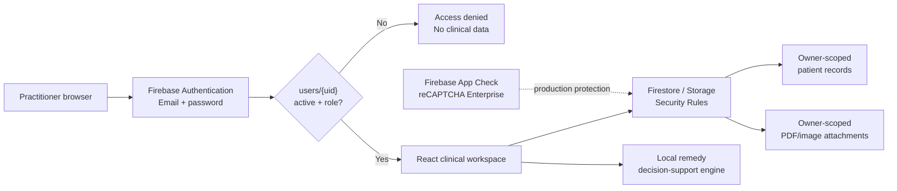

# Patient Case Manager

Firebase-ready patient case management workspace with a restricted practitioner login and an embedded homeopathy remedy-review module.

## Security posture

The application has no public registration flow. Signing in is only the first gate: a Firebase Authentication account must also have an active practitioner authorization document before any patient data can be read or written.



### Authorization document

For every designated practitioner, create a Firestore document at:

```text
users/{AUTH_UID}
```

with:

```text
active: true
role: "practitioner"   # or "admin"
displayName: "Dr Example"
email: "doctor@example.com"
```

Clients may read their own authorization document but cannot create or modify it. Patient data requires both authentication and an active `practitioner` or `admin` profile in Security Rules.

## Provision a practitioner

1. In **Firebase Console → Authentication → Users**, create the practitioner account.
2. Copy the user's Firebase Authentication **UID**.
3. In **Firestore**, create `users/{UID}`.
4. Set `active: true` and `role: "practitioner"` (or `"admin"`).
5. To revoke access immediately, set `active: false` or disable/delete the Authentication account.

The web UI deliberately has no **Create account** button. A user who somehow creates/authenticates an unapproved Firebase account still cannot enter the workspace or access clinical data because authorization is enforced by Firestore/Storage rules.

For environments that require preventing unauthorized account creation at the Authentication service itself, Firebase Authentication with Identity Platform supports auth blocking functions. The data authorization rules in this repository remain required even when blocking functions are used.

## What is included

- Sign-in-only practitioner login
- Firebase Email/Password authentication
- Active practitioner/admin authorization gate
- Owner-scoped Cloud Firestore patient records
- Structured patient demographics and clinical history
- Longitudinal consultation/case timeline
- Characteristic symptom capture: location, sensation, modalities, and concomitants
- Transparent traditional homeopathy pattern matching with matched-characteristic explanations
- Emergency red-flag blocking before remedy ranking
- Responsive glassmorphic UI for desktop, tablet, and mobile
- Browser fallback when backdrop blur is unavailable
- Firebase Hosting SPA configuration and response security headers
- Firestore and Storage Security Rules
- Optional Firebase App Check / reCAPTCHA Enterprise initialization
- Unit tests for the remedy engine
- Firestore Security Rules emulator tests
- GitHub Actions CI for tests and production build

> The remedy module is practitioner decision support, not a diagnosis or prescription. It intentionally does not provide potency or dosing instructions. Homeopathy has not been shown to be an effective treatment for medical conditions beyond placebo; conventional evaluation and treatment should not be delayed, especially for urgent symptoms.

## Local setup

Prerequisites: Node.js 22+, npm, and Java 21+ for Firestore emulator tests.

```bash
git checkout main
git pull origin main
npm install
cp .env.example .env.local
npm run dev
```

Create a Firebase Web App and place its public configuration in `.env.local`:

```dotenv
VITE_FIREBASE_API_KEY=...
VITE_FIREBASE_AUTH_DOMAIN=...
VITE_FIREBASE_PROJECT_ID=...
VITE_FIREBASE_STORAGE_BUCKET=...
VITE_FIREBASE_MESSAGING_SENDER_ID=...
VITE_FIREBASE_APP_ID=...

# Keep empty for normal localhost development unless you specifically configure App Check debugging.
VITE_RECAPTCHA_ENTERPRISE_SITE_KEY=
```

Before testing the new authorization gate against a real Firebase development project, deploy the updated rules:

```bash
npx firebase-tools login
npx firebase-tools use --add
npx firebase-tools deploy --only firestore:rules,storage
```

Then provision a practitioner using the steps above and open the Vite URL, normally `http://localhost:5173`.

## Firebase configuration

In Firebase Console:

1. Enable **Authentication → Sign-in method → Email/Password**.
2. Create the **Cloud Firestore** database.
3. Create/enable **Cloud Storage** if attachments will be used.
4. Add the Hosting production domain under Authentication authorized domains.
5. Provision designated users in Authentication and `users/{uid}`.
6. For production, configure **App Check with reCAPTCHA Enterprise**, set `VITE_RECAPTCHA_ENTERPRISE_SITE_KEY`, validate metrics, and then enable App Check enforcement.

Do not put Firebase Admin credentials, service-account JSON, or private keys into Vite environment variables. Firebase Web App configuration is public configuration; authorization is enforced by Authentication, App Check, and Security Rules.

## Test and build

```bash
npm test
npm run test:rules
npm run build
```

`npm run test:rules` starts the Firestore emulator against a demo project ID and does not touch production data.

The rule test suite verifies:

- approved practitioners can access their own patient data;
- authenticated but unprovisioned accounts are denied;
- inactive practitioners are denied;
- clients cannot grant themselves a role;
- practitioners cannot read another practitioner's patient record;
- anonymous access is denied;
- nested case ownership is enforced;
- patient ownership cannot be transferred by the client.

## Firestore model

```text
users/{uid}
  active
  role
  displayName
  email

patients/{patientId}
  ownerId
  demographics/history...

patients/{patientId}/cases/{caseId}
  ownerId
  structured consultation fields...

patients/{patientId}/suggestions/{suggestionId}
  ownerId
  caseInput
  suggestions[]
  redFlags[]
  engineVersion

patients/{patientId}/followUps/{followUpId}
patients/{patientId}/prescriptions/{prescriptionId}
```

All clinical data is owner-scoped. Frontend queries constrain patients by `ownerId`, and Security Rules independently enforce the same ownership and practitioner-approval requirements.

## Firebase deployment

```bash
npm run build
npx firebase-tools deploy
```

`firebase.json` deploys `dist/` through Firebase Hosting, rewrites SPA routes to `index.html`, adds clickjacking/content-type/referrer/permissions headers, disables caching for `index.html`, and gives hashed assets long-lived caching.

### GitHub Actions deployment

`.github/workflows/firebase-deploy.yml` provides a manual **Deploy Firebase** workflow.

Configure repository variables:

- `VITE_FIREBASE_API_KEY`
- `VITE_FIREBASE_AUTH_DOMAIN`
- `VITE_FIREBASE_PROJECT_ID`
- `VITE_FIREBASE_STORAGE_BUCKET`
- `VITE_FIREBASE_MESSAGING_SENDER_ID`
- `VITE_FIREBASE_APP_ID`
- `VITE_RECAPTCHA_ENTERPRISE_SITE_KEY` (production App Check; optional until configured)

Add `FIREBASE_SERVICE_ACCOUNT` as a GitHub Actions secret containing a deployment service-account JSON credential with only the permissions required to deploy the enabled Firebase resources.

## Recommended production hardening

Before storing real patient data, complete a jurisdiction-specific privacy/compliance review and add operational controls such as audit logging, backup/retention policy, account lifecycle procedures, monitoring, and—where appropriate—multi-factor authentication. App Check helps reject requests from unauthorized clients, but it complements rather than replaces Authentication and Security Rules.
